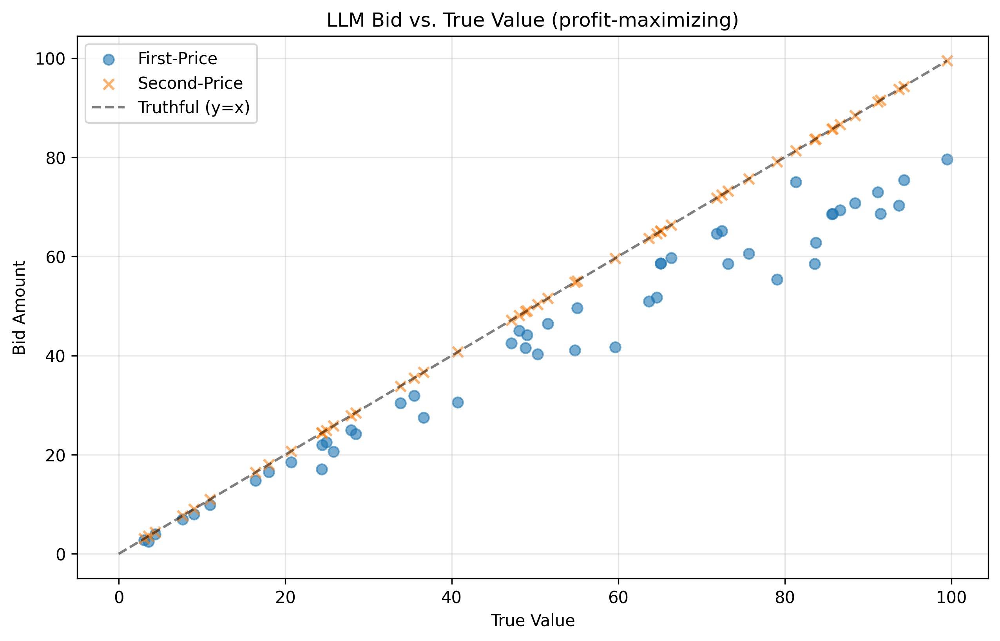

# GPT-4o Auction Bidding

**Does GPT-4o know when to bid its true value and when to shade? A small empirical test in
first-price and second-price sealed-bid auctions, across four prompted personas and a
budget-constrained variant.**



Auction theory gives two sharp, opposite answers that are easy to check. In a second-price auction
the winner pays the runner-up's bid, so bidding your true value is a dominant strategy. In a
first-price auction the winner pays its own bid, so bidding your value guarantees zero profit and
the right move is to bid below it. A model that has memorised one slogan ("bid your value") would get
one mechanism wrong. This project puts GPT-4o in repeated auctions against scripted bidders, runs
both mechanisms on the same private values every round, and logs each bid together with the model's
written reasoning.

```
each round: private values drawn uniformly from [0, 100] for GPT-4o and 3 scripted bidders
    ->  GPT-4o (temperature 0, JSON reply) bids once per mechanism, persona named in the prompt
    ->  first-price: the winner pays its own bid   |   second-price: the winner pays the runner-up
    ->  log value, bid, winner, price, profit and the model's reasoning
    ->  bid-to-value ratio, win rate and profit by persona and mechanism
```

Bid your value only when the rules reward it.

## The core idea

1. **Paired mechanisms.** Every round runs a first-price and a second-price auction on the same
   values, so any difference in the model's bid comes from the rules, not the draw.
2. **Fixed, legible opponents.** A truthful bidder (bids its value), a strategic bidder (bids 70% of
   its value) and a random bidder (uniform between 0 and its value). Simple rivals keep the outcome
   interpretable.
3. **Personas as a framing test.** The same prompt with "honest", "profit-maximizing", "risk-averse"
   or "risk-seeking" tests whether a word in the prompt moves the strategy.
4. **Budget pressure (Experiment 2).** Each mechanism gets a $500 budget. Payments are deducted, bids
   are capped at what is left, and below 10% of the budget a critical-alert line is added to the
   system prompt. Streaks of losses or wins add a nudge to bid higher or not overpay.

## What it does (measured on two experiments of 400 bids each)

Experiment 1, 50 rounds per persona, both mechanisms each round (`data/results.csv`):

| Persona | First-price bid / value (mean) | Second-price bid / value (mean) | Second-price bids within 1% of value | GPT-4o profit, first / second price |
|---|---|---|---|---|
| honest | 0.912 | 1.000 | 50 of 50 | 97.55 / 478.42 |
| profit-maximizing | **0.836** | 1.000 | 50 of 50 | 310.01 / 746.94 |
| risk-averse | 0.886 | 1.000 | 50 of 50 | 124.74 / 475.48 |
| risk-seeking | 0.929 | 1.010 | 28 of 50 | 81.93 / 557.36 |
| **all** | **0.890**, all 200 below value | **1.003**, median 1.000 | **178 of 200** | 614.23 / 2,258.19 |

GPT-4o shaded every first-price bid and bid its value in almost every second-price auction, under
every persona. The persona changed how much it shaded: profit-maximizing shaded most (down to 0.70 of
value), risk-seeking least. Risk-seeking was also the one persona that overbid in second-price
auctions, 22 times by more than 1% and by up to 4.9%. Across personas GPT-4o won 70 of 200
first-price auctions and 86 of 200 second-price ones.

Experiment 2, $500 per mechanism, 50 rounds per persona (`data/budget_results.csv`): every
persona-mechanism pair fell below the 10% crisis line, in first-price by rounds 9 to 21 and in
second-price by rounds 17 to 43. Three of the four first-price budgets reached $0.00; no second-price
budget did. The crisis prompt was active in 202 of the 400 bids.

All numbers are computed from the committed CSVs; the per-persona statistics are the bid-to-value
ratio, win rate and profit that `analysis/exp1_metrics.py` reports.

## How it works

**Auctions.** `auctions/first_price.py` and `auctions/second_price.py` clear a list of bids; the
highest bid wins and ties go to the earlier bidder. Experiment 1 orders the bidders truthful,
strategic, random, GPT-4o; Experiment 2 puts GPT-4o first.

**The agent.** `agents/llm_agent.py` sends a system prompt that demands a JSON object with
`reasoning` and `bid`, and a user prompt with the mechanism, the private value, the persona, the
remaining budget (Experiment 2) and the last five rounds. It calls `gpt-4o` at temperature 0 with up
to three retries, and falls back to a bid of 0 if the API keeps failing. If the reply is not valid
JSON it strips Markdown fences, then takes the last number in the text.

**Experiments.** `run_simulation.py` runs Experiment 1 and appends to `data/results.csv` and
`data/reasoning_logs.csv`. `budget_experiment/run_budget_simulation.py` runs Experiment 2 with
separate budget pools for the two mechanisms and records which prompt regime (neutral, crisis,
adaptive aggressive, adaptive conservative) produced each bid.

**Analysis.** `analysis/exp1_metrics.py` computes bid-to-value ratios, win rates, profit and market
efficiency. `budget_experiment/analysis/exp2_metrics.py` reports budget use, bankruptcy rate and
round, the response to the crisis prompt, and end-game behavior. `analysis/statistical_tests.py` runs
Welch t-tests and Mann-Whitney tests between mechanisms. `analysis/reasoning_analysis.py` counts
auction-theory keywords in the reasoning. `analysis/graphs.py` draws the scatter, histogram, trend and
profit plots.

## Run it

```bash
pip install -r requirements.txt     # analysis/statistical_tests.py also needs scipy
# put your key in config.py (OPENAI_API_KEY); the environment variable is read only when that field is empty
chmod +x run_all_experiments.sh
./run_all_experiments.sh            # 4 personas x 2 experiments x 50 rounds, then metrics and plots
```

The full run makes up to 800 GPT-4o calls and deletes the CSVs in `data/` before it starts. Single
pieces:

```bash
python run_simulation.py --rounds 50 --persona risk-averse
python budget_experiment/run_budget_simulation.py --rounds 50 --budget 500 --persona honest
python analysis/exp1_metrics.py
python analysis/statistical_tests.py
```

If both the config field and the environment variable are empty, the agent switches to a fixed rule
per persona and tags its rows `mock`, which is enough to dry-run the pipeline.

## Layout

```
run_simulation.py              Experiment 1: four bidders, both mechanisms every round
budget_experiment/
  run_budget_simulation.py     Experiment 2: $500 per mechanism, crisis prompt below 10%
  analysis/                    budget metrics, tests, plots
agents/                        GPT-4o agent, truthful, 70% strategic and random bidders
auctions/                      first-price and second-price clearing
analysis/                      Experiment 1 metrics, significance tests, reasoning keywords, plots/
data/                          results and budget results (400 rows each), reasoning logs and samples
config.py                      rounds, value range, personas, model name, API key
run_all_experiments.sh         every persona and experiment, then all analysis
```

## Honesty

* Small sample. One run per persona, 50 rounds per mechanism, values drawn without a fixed seed, so a
  rerun sees different auctions. The repo stores no confidence intervals or test outputs.
* Experiment 1 is one-shot in practice. `run_simulation.py` never calls `update_history`, so GPT-4o
  sees "No previous history" every round and the losing-streak prompts never fire (every row is
  `neutral`). Only Experiment 2 feeds history back.
* In Experiment 2 one agent bids in both mechanisms, so its "recent history" mixes first-price and
  second-price outcomes, and its reasoning sometimes cites the other auction.
* The budget only drains. Winning costs money and profit is never added back, so every run drifts
  into the crisis regime; the budget results describe that design, not general budget behavior.
* The rivals are scripted and fixed. The data shows the direction of shading, not whether its size
  is optimal against these bidders.
* Some committed plots are stale. The low-resolution top-level PNGs in `analysis/plots/` (1000 x 600
  and 1200 x 600) and the plots in `budget_experiment/analysis/plots/` come from earlier runs and do
  not match the CSVs (one shows a $100 budget over 10 rounds). The plots in the `analysis/plots/`
  subfolders and `analysis/plots/budget_over_time.png` match the data.
* `data/reasoning_summary_stats.csv` has no generating script in the repo, so its columns are not
  used here.

MIT licensed.
